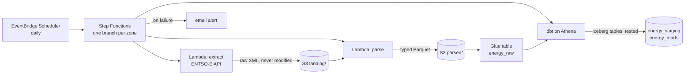

# European day-ahead electricity prices, on AWS

[](https://github.com/OtoTediashvili/energy-data-aws/actions/workflows/ci.yml)

[energy-data-pipeline](https://github.com/OtoTediashvili/energy-data-pipeline)
collects the next day's wholesale electricity prices from ENTSO-E every day
and turns them into a tested star schema, on one laptop: Airflow, dbt and
DuckDB in Docker. Its README ends with what I would change at a hundred
times the volume: object storage for the landing zone, and Iceberg tables
instead of a single-writer database.

This repository is that change, made for real: the same pipeline,
serverless on AWS, every resource in Terraform, deployed from GitHub
Actions without a stored key, for a few cents a month.

## Where it is going



| Step | What | Status |
|---|---|---|
| 1 | Foundation: state bucket, data lake bucket, Glue databases, Athena workgroup with a scan limit, budget alert | ready to apply |
| 2 | Ingestion: extract and parse as Lambda functions, the ENTSO-E token from SSM | |
| 3 | dbt on Athena: staging, the zone dimension and daily prices as Iceberg tables, with the tests | |
| 4 | Orchestration: Step Functions on a schedule, failure alerts, backfill from project 1's landing zone | |
| 5 | CI/CD: GitHub Actions deploys through OIDC, no stored keys | |
| 6 | What it costs, what broke, what I'd change | |

## Setup

Once per machine and account. You need the AWS CLI 2.32 or newer, Terraform
1.11 or newer, `make`, and [uv](https://docs.astral.sh/uv/) for `make scan`.

1. **An AWS account,** from "Sign up for AWS (advanced)", on the Free plan.
   Protect the root user with MFA, then create an IAM user with console
   access, MFA and administrator rights for everyday use, without access
   keys. Use Europe (Frankfurt), `eu-central-1`.
2. **CLI credentials without keys.** `aws login` turns a console sign-in
   into credentials that last at most 12 hours. Terraform reads them
   through a second profile:

   ```bash
   aws configure set region eu-central-1 --profile energy-login
   make login          # aws login --remote: open the URL, sign in, paste the code
   cat >> ~/.aws/config <<'EOF'

   [profile energy]
   region = eu-central-1
   credential_process = aws configure export-credentials --profile energy-login --format process
   EOF
   make whoami
   ```

3. **The ENTSO-E token in SSM Parameter Store,** encrypted, typed at a
   hidden prompt so it never reaches the shell history:

   ```bash
   read -rsp "ENTSO-E token: " T; echo
   aws ssm put-parameter --profile energy --name /energy/entsoe/token --type SecureString --value "$T"; unset T
   ```

4. **The infrastructure:**

   ```bash
   make bootstrap      # the Terraform state bucket, once
   cp infra/terraform.tfvars.example infra/terraform.tfvars   # your email for budget alerts
   make init plan      # read the plan
   make apply
   make smoke          # a query through Athena, end to end
   ```

## Guard rails

- **No long-lived keys.** Your laptop uses `aws login`; GitHub Actions will
  use OIDC. There is no access key to leak.
- **The token never touches the repo.** It lives in SSM as a SecureString;
  the extract function will read it at run time.
- **Cost caps.** A monthly budget emails at 50% and 100% of $5, and when
  the forecast passes it, counting usage before credits. The Athena
  workgroup cancels any query that would scan more than 1 GiB.
- **Buckets** block public access, refuse non-HTTPS requests, encrypt at
  rest and keep 30 days of overwritten or deleted objects.
- **checkov** checks the Terraform in CI; the few checks skipped are
  explained in [.checkov.yaml](.checkov.yaml).

## Commands

| Command | What it does |
|---|---|
| `make login` | Short-lived credentials for the `energy` profile |
| `make bootstrap` | Create the Terraform state bucket (once) |
| `make init` / `plan` / `apply` | Terraform, with the plan saved and applied exactly as shown |
| `make validate` / `scan` | Format, syntax and security checks; no AWS needed |
| `make smoke` | One query through the Athena workgroup |
