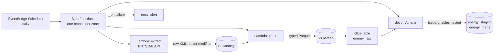

# European day-ahead electricity prices, on AWS

[](https://github.com/OtoTediashvili/energy-data-aws/actions/workflows/ci.yml)

[energy-data-pipeline](https://github.com/OtoTediashvili/energy-data-pipeline)
collects the next day's wholesale electricity prices from ENTSO-E every day
and turns them into a tested star schema, on one laptop: Airflow, dbt and
DuckDB in Docker. Its README ends with what I would change at a hundred
times the volume: object storage for the landing zone, and Iceberg tables
instead of a single-writer database.

This repository is that change, made for real: the same pipeline,
serverless on AWS, every resource in Terraform, deployed from GitHub
Actions without a stored key, for a few cents a month.

## Where it is going



| Step | What | Status |
|---|---|---|
| 1 | Foundation: state bucket, data lake bucket, Glue databases, Athena workgroup with a scan limit, budget alert | done |
| 2 | Ingestion: extract and parse as Lambda functions, the ENTSO-E token from SSM, the raw table | done |
| 3 | dbt on Athena: staging, the zone dimension and daily prices as Iceberg tables, with the tests | ready to run |
| 4 | Orchestration: Step Functions on a schedule, failure alerts, backfill from project 1's landing zone | |
| 5 | CI/CD: GitHub Actions deploys through OIDC, no stored keys | |
| 6 | What it costs, what broke, what I'd change | |

## Ingestion

Two Lambda functions from one container image, the same split as project
1's extract and parse tasks:

| Function | Does | Writes |
|---|---|---|
| `energy-extract` | Asks ENTSO-E for one zone's UTC day, refuses an error document, lands the bytes unmodified | `landing/dataset=prices/zone=NL/year=2026/month=10/prices_NL_2026-10-30.xml` |
| `energy-parse` | Parses that file with project 1's parser (unchanged), adds the lineage columns | `parsed/…/prices_NL_2026-10-30.parquet` |

- **The same layout as project 1's `data/` folder,** so its year of landed
  XML copies over as it is, and is parsed again in the cloud.
- **No load step.** `energy_raw.day_ahead_prices` is a Glue table over
  `parsed/`, with partition projection: Athena derives the partitions from
  the zones and a range of months, so there is no crawler to run and nothing
  to repair after a backfill. Parsing a day again overwrites its one file,
  which replaces that delivery, exactly as project 1's load did.
- **The token** is read from SSM at run time and cached while the container
  is warm. It is added to the request in one function only, never logged,
  and a failed request is re-raised without its traceback. Tests check all
  three.
- **One image, pinned.** `scripts/image.sh` tags the image with a hash of
  its content; the repository refuses to overwrite a tag, and each function
  is pinned to the image's digest.
- **Least privilege.** The functions may read one SSM parameter, write two
  prefixes of the lake, read one, and write their own logs and traces.

The zones live in one place, `dbt/seeds/bidding_zones.csv`: the Glue
table's partitions are generated from it, and so will the state machine's
branches be. dbt loads it as the dimension's reference.

## Transformation

Project 1's dbt project, moved from DuckDB to Athena: the same models and
the same 32 tests, in Athena's SQL (Trino).

| Model | In | Built as |
|---|---|---|
| `stg_day_ahead_prices` | `energy_staging` | a view: the main auction only, one row per zone and market time unit (highest revision, then latest delivery), with its market day in Brussels time |
| `dim_bidding_zone` | `energy_marts` | an Iceberg table: one row per zone, named from the seed |
| `fct_daily_prices` | `energy_marts` | an incremental Iceberg table, one row per zone and market day, merged |

- **Iceberg, merged by arrival time.** Each build finds every market day
  that received a delivery since the table was last built, whatever its
  date, and rebuilds that day whole with one atomic `MERGE`. Project 1 did
  the same with delete+insert in DuckDB; its reconciliation test
  (`assert_fct_matches_staging`) still guards it.
- **Market days in Brussels time,** by a zone-aware conversion in one macro
  (`market_date`), used by the model and by the test that checks it.
- **No packages to download.** The two generic tests and the surrogate key
  that came from dbt_utils are small macros here, so building the transform
  image later needs nothing from the internet.
- **Tested where it runs.** `dbt build` runs the 4 unit tests and 28 data
  tests in Athena, each query held to the workgroup's scan limit. CI parses
  the project without AWS; from step 5 it will build it too.

## Setup

Once per machine and account. You need the AWS CLI 2.32 or newer, Terraform
1.11 or newer, Docker, `make`, and [uv](https://docs.astral.sh/uv/).

1. **An AWS account,** from "Sign up for AWS (advanced)", on the Free plan.
   Protect the root user with MFA, then create an IAM user with console
   access, MFA and administrator rights for everyday use, without access
   keys. Use Europe (Frankfurt), `eu-central-1`.
2. **CLI credentials without keys.** `aws login` turns a console sign-in
   into credentials that last at most 12 hours. Terraform reads them
   through a second profile:

   ```bash
   aws configure set region eu-central-1 --profile energy-login
   make login          # aws login --remote: open the URL, sign in, paste the code
   cat >> ~/.aws/config <<'EOF'

   [profile energy]
   region = eu-central-1
   credential_process = aws configure export-credentials --profile energy-login --format process
   EOF
   make whoami
   ```

3. **The ENTSO-E token in SSM Parameter Store,** encrypted, typed at a
   hidden prompt so it never reaches the shell history:

   ```bash
   read -rsp "ENTSO-E token: " T; echo
   aws ssm put-parameter --profile energy --name /energy/entsoe/token --type SecureString --value "$T"; unset T
   ```

4. **The infrastructure:**

   ```bash
   make install        # Python environment and git hooks
   make bootstrap      # the Terraform state bucket and the image registry
   cp infra/terraform.tfvars.example infra/terraform.tfvars   # your email for budget alerts
   make image          # build the functions' image and push it (Docker running)
   make init plan      # read the plan
   make apply
   make smoke          # a query through Athena, end to end
   make ingest ZONE=NL DATE=2026-10-30
   make raw            # rows per zone and day in the raw table
   make dbt-build      # staging, dimension and fact table in Athena, with every test
   make prices         # daily prices per zone, from the marts
   ```

## Guard rails

- **No long-lived keys.** Your laptop uses `aws login`; GitHub Actions will
  use OIDC. There is no access key to leak.
- **The token never touches the repo.** It lives in SSM as a SecureString;
  the extract function will read it at run time.
- **Cost caps.** A monthly budget emails at 50% and 100% of $5, and when
  the forecast passes it, counting usage before credits. The Athena
  workgroup cancels any query that would scan more than 1 GiB.
- **Buckets** block public access, refuse non-HTTPS requests, encrypt at
  rest and keep 30 days of overwritten or deleted objects.
- **checkov** checks the Terraform in CI; the few checks skipped are
  explained in [.checkov.yaml](.checkov.yaml).

## Commands

| Command | What it does |
|---|---|
| `make login` | Short-lived credentials for the `energy` profile |
| `make install` / `check` | Python environment; lint, types and tests, as CI runs them |
| `make bootstrap` | The Terraform state bucket and the image registry |
| `make image` | Build and push the functions' image, if ECR doesn't have it yet |
| `make init` / `plan` / `apply` | Terraform, with the plan saved and applied exactly as shown |
| `make validate` / `scan` | Format, syntax and security checks; no AWS needed |
| `make smoke` | One query through the Athena workgroup |
| `make ingest ZONE=NL DATE=…` | Extract and parse one zone's day with the deployed functions |
| `make raw` | Rows per zone and day in the raw table |
| `make dbt-parse` / `dbt-build` | Check the dbt project offline / build and test it in Athena |
| `make prices` | Daily prices per zone, from the marts |
