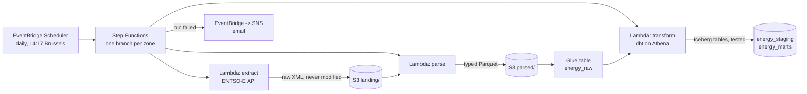

# European day-ahead electricity prices, on AWS

[](https://github.com/OtoTediashvili/energy-data-aws/actions/workflows/ci.yml)

[energy-data-pipeline](https://github.com/OtoTediashvili/energy-data-pipeline)
collects the next day's wholesale electricity prices from ENTSO-E every day
and turns them into a tested star schema, on one laptop: Airflow, dbt and
DuckDB in Docker. Its README ends with what I would change at a hundred
times the volume: object storage for the landing zone, and Iceberg tables
instead of a single-writer database.

This repository is that change, made for real: the same pipeline,
serverless on AWS, every resource in Terraform, deployed from GitHub
Actions without a stored key, for a few cents a month.

## How it works



| Step | What | Status |
|---|---|---|
| 1 | Foundation: state bucket, data lake bucket, Glue databases, Athena workgroup with a scan limit, budget alert | done |
| 2 | Ingestion: extract and parse as Lambda functions, the ENTSO-E token from SSM, the raw table | done |
| 3 | dbt on Athena: staging, the zone dimension and daily prices as Iceberg tables, with the tests | done |
| 4 | Orchestration: Step Functions on a schedule, dbt in Lambda, failure alerts, backfill from project 1's landing zone | done |
| 5 | CI/CD: GitHub Actions deploys through OIDC, no stored keys, each change approved | done |
| 6 | What it costs, what broke, what I'd change | costs still being measured |

## Ingestion

Two Lambda functions from one container image (`ingest`), the same split
as project 1's extract and parse tasks:

| Function | Does | Writes |
|---|---|---|
| `energy-extract` | Asks ENTSO-E for one zone's UTC day, refuses an error document, lands the bytes unmodified | `landing/dataset=prices/zone=NL/year=2026/month=10/prices_NL_2026-10-30.xml` |
| `energy-parse` | Parses that file with project 1's parser (unchanged), adds the lineage columns | `parsed/…/prices_NL_2026-10-30.parquet` |

- **The same layout as project 1's `data/` folder,** so its year of landed
  XML copies over as it is, and is parsed again in the cloud.
- **No load step.** `energy_raw.day_ahead_prices` is a Glue table over
  `parsed/`, with partition projection: Athena derives the partitions from
  the zones and a range of months, so there is no crawler to run and nothing
  to repair after a backfill. Parsing a day again overwrites its one file,
  which replaces that delivery, exactly as project 1's load did.
- **The token** is read from SSM at run time and cached while the container
  is warm. It is added to the request in one function only, never logged,
  and a failed request is re-raised without its traceback. Tests check all
  three.
- **Two images, pinned.** One Dockerfile builds `ingest` (no dbt) and
  `transform` (dbt and the project). `scripts/image.sh` tags both with one
  hash of everything they contain; the repository refuses to overwrite a
  tag, and each function is pinned to its image's digest.
- **Least privilege.** The functions may read one SSM parameter, write two
  prefixes of the lake, read one, and write their own logs and traces.

The zones live in one place, `dbt/seeds/bidding_zones.csv`: the Glue
table's partitions and the state machine's branches are generated from it,
and dbt loads it as the dimension's reference.

## Transformation

Project 1's dbt project, moved from DuckDB to Athena: the same models and
the same 32 tests, in Athena's SQL (Trino).

| Model | In | Built as |
|---|---|---|
| `stg_day_ahead_prices` | `energy_staging` | a view: the main auction only, one row per zone and market time unit (highest revision, then latest delivery), with its market day in Brussels time |
| `dim_bidding_zone` | `energy_marts` | an Iceberg table: one row per zone, named from the seed |
| `fct_daily_prices` | `energy_marts` | an incremental Iceberg table, one row per zone and market day, merged |

- **Iceberg, merged by arrival time.** Each build finds every market day
  that received a delivery since the table was last built, whatever its
  date, and rebuilds that day whole with one atomic `MERGE`. Project 1 did
  the same with delete+insert in DuckDB; its reconciliation test
  (`assert_fct_matches_staging`) still guards it.
- **Market days in Brussels time,** by a zone-aware conversion in one macro
  (`market_date`), used by the model and by the test that checks it.
- **No packages to download.** The two generic tests and the surrogate key
  that came from dbt_utils are small macros here, so the transform image
  needs nothing from the internet to run.
- **Tested where it runs.** `make dbt-build` runs the 4 unit tests and 28
  data tests in Athena, each query held to the workgroup's scan limit. The
  daily build in Lambda runs every data test; the unit tests test the SQL,
  not the data, so they stay here and in CI.

## Orchestration

Two state machines in Step Functions, both ending in the transform
function, which runs `dbt build` in Lambda.

| State machine | Started by | Does |
|---|---|---|
| `energy-daily` | EventBridge Scheduler at 14:17 Brussels time; `make run [DATE=…]` | For every zone, side by side: extract, then parse. Then dbt. |
| `energy-backfill` | `make backfill` | Parses every file in `landing/` again, then dbt |

- **Waiting for late prices.** Tomorrow's prices are usually out by 13:00.
  If ENTSO-E has nothing yet, extract fails with `NoMatchingDataError`, and
  the state machine tries again after 20, 40 and 80 minutes. A server error
  that outlasts the function's own retries gets two more tries, minutes
  apart.
- **One zone failing doesn't stop the others.** Its error is caught, the
  rest still go through dbt, and the run then fails, naming the zone, the
  day and the error.
- **An email when a run fails,** times out or is stopped: an EventBridge
  rule on the run's status, to SNS, with a link to the run in the console.
- **dbt in Lambda.** The transform image holds dbt and the project and
  writes only to `/tmp`. Lambda has no shared memory, which
  multiprocessing's locks need, and dbt creates such locks although it
  runs in threads; the function swaps them for thread locks first. The test
  makes lock creation fail the way Lambda does, and CI parses the project
  inside the image with a read-only filesystem.
- **The backfill copies, never overwrites.** `make backfill` uploads from
  project 1's `data/landing` only the days the lake doesn't have, then
  parses all of `landing/` with a distributed map, five files at a time (a
  new account may run ten functions at once).
- **Tested before AWS sees them.** The definitions in
  `infra/state_machines/` are JSON with JSONata expressions. The tests
  render them as Terraform does and evaluate those expressions: the day a
  scheduled run picks, the report of a failed zone, the zone and date of a
  landed key. `make sfn-check` runs AWS's own validator on them.

## Deployment

GitHub Actions checks every push. On `main` it also plans, and a change to
AWS waits until I approve it.

| Job | Runs | May do on AWS |
|---|---|---|
| Lint, types, tests · Images build · Terraform validate · checkov · shellcheck · secret scan | every push and pull request | nothing |
| Push images, plan | on `main`, once every check has passed | push the images, read the stack (`github-energy-plan`) |
| Apply | only when the plan changes something, and only after I approve it | change this project's resources (`github-energy-apply`) |

- **No stored keys.** For each job, GitHub signs a short-lived token that
  names the repository and the branch or environment. AWS checks it and
  hands out an hour of one role's credentials. The roles trust GitHub's
  immutable subject (owner and repository IDs, not names), so a repository
  deleted and created again under the same name gets nothing.
- **A push alone changes nothing.** The plan role reads the stack and pushes
  images. The apply role trusts only jobs in the GitHub environment
  `production`, which waits for my approval.
- **What I approve is what runs.** A plan file holds every value in plain
  text, and a public repository's run files are public, so the apply job
  doesn't reuse it. It plans again and applies only if the same resources
  change in the same ways (`scripts/ci_plan.sh`).
- **CI can't widen its own rights.** The CI roles and the boundary below
  live in a separate stack, `infra/bootstrap/`, which only the laptop
  applies.
- **A ceiling for every role CI writes.** The apply role creates the
  pipeline's roles, so it could write any policy into them. It may only
  create or change a role that carries the permissions boundary
  `energy-workload-boundary`, and may not remove it. Whatever a role's own
  policy says, it can't reach past this project's resources or into IAM.
- **Public logs, private values.** The account ID and the alert email are
  GitHub secrets, which GitHub masks, and the email is a sensitive Terraform
  variable, so plans don't print it.

## Setup

Once per machine and account. You need the AWS CLI 2.32 or newer, Terraform
1.11 or newer, Docker, `make`, and [uv](https://docs.astral.sh/uv/).

1. **An AWS account,** from "Sign up for AWS (advanced)", on the Free plan.
   Protect the root user with MFA, then create an IAM user with console
   access, MFA and administrator rights for everyday use, without access
   keys. Use Europe (Frankfurt), `eu-central-1`.
2. **CLI credentials without keys.** `aws login` turns a console sign-in
   into credentials that last at most 12 hours. Terraform reads them
   through a second profile:

   ```bash
   aws configure set region eu-central-1 --profile energy-login
   make login          # aws login --remote: open the URL, sign in, paste the code
   cat >> ~/.aws/config <<'EOF'

   [profile energy]
   region = eu-central-1
   credential_process = aws configure export-credentials --profile energy-login --format process
   EOF
   make whoami
   ```

3. **The ENTSO-E token in SSM Parameter Store,** encrypted, typed at a
   hidden prompt so it never reaches the shell history:

   ```bash
   read -rsp "ENTSO-E token: " T; echo
   aws ssm put-parameter --profile energy --name /energy/entsoe/token --type SecureString --value "$T"; unset T
   ```

4. **The infrastructure:**

   ```bash
   make install        # Python environment and git hooks
   make bootstrap      # state bucket, image registry, CI roles, permissions boundary
   cp infra/terraform.tfvars.example infra/terraform.tfvars   # your email for alerts
   make image          # build both images and push them (Docker running)
   make sfn-check      # AWS's validator on the state machines
   make init plan      # read the plan
   make apply          # then confirm the alert subscription in your email
   make smoke          # a query through Athena, end to end
   make run            # today, every zone, then dbt; or make run DATE=2026-11-02
   make backfill       # project 1's history, from ~/projects/de-pipeline/data/landing
   make prices         # daily prices per zone, from the marts
   ```

   From then on the schedule runs it every afternoon.

5. **Deploying from GitHub** (optional). In your copy of the repository:
   - Set `github_subject_prefix` in `infra/bootstrap/ci.tf` to the start of
     your repository's token subject (see what broke, below). `gh api
     repos/OWNER/REPO/actions/oidc/customization/sub` shows its format.
     Run `make bootstrap` again.
   - Add two secrets, `AWS_ACCOUNT_ID` and `ALERT_EMAIL`, with
     `gh secret set NAME`, typing the value at its prompt.
   - Create the environment `production` (Settings, Environments), with
     yourself as required reviewer and `main` as its only branch. Do it
     before the first push: GitHub creates an environment a workflow names
     if it doesn't exist, without any protection.

## Guard rails

- **No long-lived keys.** The laptop uses `aws login`; GitHub Actions uses
  OIDC. There is no access key to leak.
- **No change without approval.** CI applies only after I approve the plan,
  and every role it writes stays inside a permissions boundary
  ([Deployment](#deployment)).
- **The token never touches the repo.** It lives in SSM as a SecureString;
  the extract function reads it at run time.
- **A failed run emails you,** with the error and a link to the run.
- **Cost caps.** A monthly budget emails at 50% and 100% of $5, and when
  the forecast passes it, counting usage before credits. The Athena
  workgroup cancels any query that would scan more than 1 GiB.
- **Buckets** block public access, refuse non-HTTPS requests, encrypt at
  rest and keep 30 days of overwritten or deleted objects.
- **checkov** checks the Terraform in CI; the few checks skipped are
  explained in [.checkov.yaml](.checkov.yaml).

## What it costs

Measured from Cost Explorer once the schedule has run for a few weeks.
Every resource carries the tag `project = energy-data-aws`, active as a cost
allocation tag since 9 November 2026, so the project's cost can be read on
its own.

## What broke

Each of these failed once. The fixes are in place, most with a test or a
comment where the mistake would happen again.

- **dbt in Lambda.** Lambda has no `/dev/shm`, so the multiprocessing locks
  dbt creates fail with "[Errno 38] Function not implemented", although dbt
  runs in threads. The function swaps them for thread locks before dbt
  starts. The image is read-only too, so dbt writes only under `/tmp`.
- **A folder name.** The dbt project first went to `/var/task/dbt`, which is
  where the dbt package itself is installed. It lives in
  `/var/task/dbt_project` now.
- **Image format.** Lambda rejects the image indexes Docker builds by
  default, with build provenance attached. The images are built with
  `--provenance=false`.
- **Timestamp precision.** Iceberg tables need `timestamp(6)`. dbt's unit
  tests build Hive scratch tables, which only take `timestamp(3)`. One
  macro, `table_timestamp`, picks the right one.
- **"Nothing" in JSONata.** A filter that matches nothing returns undefined,
  not an empty list, and Step Functions fails a run that tries to store
  undefined. The first backfill parsed all 1,574 files and then failed,
  because none had failed. The tests now refuse undefined, as AWS does.
- **An escaped placeholder.** `jsonencode()` turns `<` and `>` into
  `<` and `>`, so the scheduler never filled in its
  `<aws.scheduler.scheduled-time>` placeholder. That input is a literal
  string now.
- **Ten functions at once.** A new account may run only ten Lambda
  functions at the same time. The backfill parses five files at a time,
  and no function reserves concurrency.
- **The OIDC subject.** This repository's tokens name it by IDs
  (`repo:OtoTediashvili@142446890/energy-data-aws@1441335391:…`), not by
  name. A trust policy with the plain name failed with "Not authorized to
  perform sts:AssumeRoleWithWebIdentity".
- **An email in a public log.** Marking a Terraform variable `sensitive`
  hides its new value, not the old value already in the state. The first
  CI plan printed the alert email from the state until an apply from the
  laptop marked it there. The log was deleted.
- **A secret that didn't match.** The `ALERT_EMAIL` secret didn't exactly
  match the address in use, so CI planned to replace the email
  subscription, and GitHub didn't mask the address, since it masks exact
  matches only. The CI plan disagreeing with the laptop's is what gave it
  away.

## What I'd change at a bigger scale

- **Accounts per environment.** One account, and CI applies straight to
  it. A team would have development and production accounts in AWS
  Organizations, with service control policies as the ceiling the
  permissions boundary is here.
- **Plans on pull requests.** The plan role trusts only `main`, so a pull
  request is checked but not planned. With more people, each pull request
  from the repository itself (never a fork) would get its plan as a
  comment.
- **Alerts on silence, not only on failure.** A run that fails sends an
  email. A run that never starts sends nothing. A dbt source freshness
  check, or an alarm when no run succeeds in a day, would catch that.
- **Table maintenance.** Every daily merge adds an Iceberg snapshot and a
  few small files. At this size that costs nothing. At a larger one,
  Athena's `OPTIMIZE` and `VACUUM` would run on a schedule.
- **dbt outside Lambda.** Lambda stops a function after 15 minutes. A build
  that could outgrow that would run the same image as a Fargate task,
  started by the same state machine.

## Commands

| Command | What it does |
|---|---|
| `make login` | Short-lived credentials for the `energy` profile |
| `make install` / `check` | Python environment; lint, types and tests, as CI runs them |
| `make bootstrap` | The Terraform state bucket, the image registry, the CI roles and the permissions boundary |
| `make image` | Build and push the two images, if ECR doesn't have them yet |
| `make sfn-check` | AWS's own validator on the state machine definitions |
| `make init` / `plan` / `apply` | Terraform, with the plan saved and applied exactly as shown |
| `make validate` / `scan` | Format, syntax and security checks; no AWS needed |
| `make smoke` | One query through the Athena workgroup |
| `make run` / `make run DATE=…` | The daily state machine, for today or one day; waits and prints the result |
| `make backfill` | Copy project 1's landed files the lake lacks, parse all of landing/, rebuild |
| `make ingest ZONE=NL DATE=…` | Extract and parse one zone's day with the deployed functions |
| `make raw` | Rows per zone and day in the raw table |
| `make dbt-parse` / `dbt-build` | Check the dbt project offline / build and test it in Athena |
| `make prices` | Daily prices per zone, from the marts |
| `make docs` | dbt's docs and lineage graph on http://localhost:8080 |
